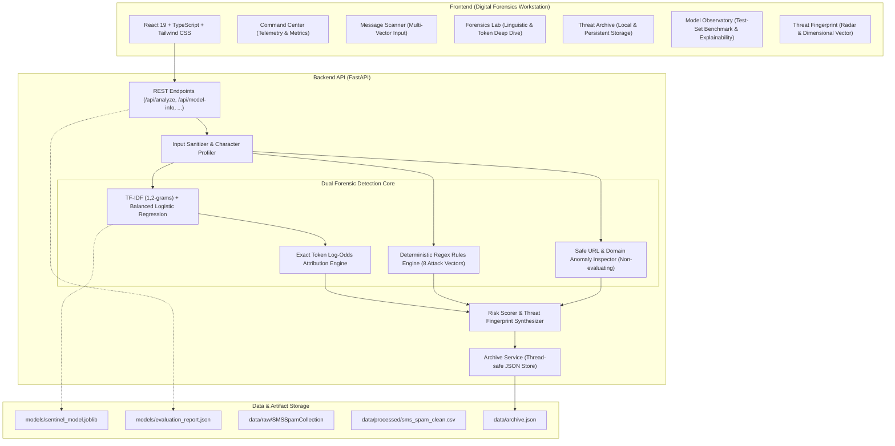

# SENTINEL AI — Cyber Threat Intelligence & Message Forensics Platform

[](https://github.com)
[](https://python.org)
[](https://fastapi.tiangolo.com)
[](https://react.dev)
[](https://scikit-learn.org)

> **“What makes this message suspicious, what evidence supports that assessment, and what should the user do next?”**

SENTINEL AI is an intelligent message-security and digital forensics workbench designed for cyber threat intelligence analysts, incident response operators, and security researchers. It conducts deep, explainable forensic analysis of emails, SMS messages (smishing), and untrusted inbound text to uncover deceptive lures, brand impersonation, credential harvesting forms, and coercive social-engineering pressure tactics.

---

## 1. Distinctive Visual Language — "Digital Forensics Terminal"

SENTINEL AI adopts a high-contrast forensic workstation aesthetic:
- **Core Canvas:** Deep graphite and near-black (`#0B0D10`, `#13171C`, `#191F26`).
- **Signature Threat Fingerprint:** Original multi-axis visual radar combining Urgency, Impersonation, Suspicious Links, Credential Solicitation, Financial Pressure, and Formatting Obfuscation.
- **Electric Accent Signals:** Electric acid-lime (`#C7F464`), muted cyan (`#65D8D0`), warm amber (`#F4B860`), and restrained coral-red (`#FF626E`).
- **Typography:** Sans-serif editorial display headings paired with high-legibility monospace fonts (`JetBrains Mono`, `Consolas`) for technical evidence traces.
- **Passive Link Sandboxing:** Non-executable lexical inspection of all extracted URLs, detecting IP-based destinations, shortening services, and lookalike domains.

---

## 2. Core Capabilities & Forensic Workflow

1. **Dual-Layer Forensic Detection Core:**
   - **Machine-Learning Layer:** TF-IDF $(1, 2)$-gram vectorization with balanced Logistic Regression trained on the UCI SMS Spam Collection.
   - **Deterministic Evidence Engine:** 8 attack pattern categories with character-indexed substring matching and actionable defensive procedures.
   - **Fused Heuristic Risk Scoring:** Explainable $0 \dots 100$ risk score combined with genuine ML probability estimates.
2. **Honest Explainability (Token Log-Odds Attribution):**
   - Direct linear model feature attributions derived from learned coefficients ($w_i \cdot x_i$), identifying the exact words that pushed the model toward `SPAM` or `HAM`.
3. **Message Forensics Lab:**
   - Editor-style inspection suite featuring line-numbered payload buffers, character & uppercase metrics, analysis execution timelines, and structured JSON export.
4. **Local Investigation Archive:**
   - Zero-cloud local persistence with full search, multi-factor filtering, individual deletion, purge safeguards, and CSV/JSON export.
5. **Model Observatory:**
   - Genuine empirical evaluation metrics (98.55% accuracy, 94.12% spam F1) computed against 1,032 unseen test samples, paired with an interactive confusion matrix and vocabulary weights.

---

## 3. Architecture Specification



---

## 4. Repository Structure

```
r:/Cyber Threat Intelligence/
├── backend/
│   ├── app/
│   │   ├── api/
│   │   │   └── router.py               # REST API route handlers
│   │   ├── core/
│   │   │   └── config.py               # Application configuration & paths
│   │   ├── ml/
│   │   │   └── predictor.py            # Model inference & token attribution
│   │   ├── schemas/
│   │   │   └── forensics.py            # Pydantic data schemas
│   │   ├── services/
│   │   │   ├── evidence_engine.py      # Regex rules & URL screening
│   │   │   ├── risk_scorer.py          # Risk score & Threat Fingerprint fusion
│   │   │   ├── archive_service.py      # Persistent archive CRUD & export
│   │   │   └── samples_service.py      # Curated demonstration messages
│   │   └── main.py                     # FastAPI entrypoint & CORS middleware
│   ├── tests/
│   │   └── test_sentinel.py            # Comprehensive pytest test suite (14 tests)
│   └── requirements.txt                # Backend dependencies
├── frontend/
│   ├── src/
│   │   ├── components/
│   │   │   ├── Header.tsx              # Top telemetry & brand status bar
│   │   │   ├── Sidebar.tsx             # Left navigation rail & shortcuts
│   │   │   ├── ThreatFingerprintVisual.tsx # Hexagon radar visualizer
│   │   │   ├── CommandCenter.tsx       # Analyst operations home screen
│   │   │   ├── MessageScanner.tsx      # Multi-vector analysis workflow
│   │   │   ├── ForensicsLab.tsx        # Line-numbered payload & token lab
│   │   │   ├── ThreatArchive.tsx       # Investigation ledger & filters
│   │   │   ├── ModelObservatory.tsx    # Empirical evaluation benchmarks
│   │   │   └── SystemAbout.tsx         # Architecture & active rulebook
│   │   ├── services/
│   │   │   └── api.ts                  # Typed backend API client
│   │   ├── types/
│   │   │   └── forensics.ts            # Frontend TypeScript definitions
│   │   ├── App.tsx                     # Root state & view orchestration
│   │   ├── index.css                   # Custom scrollbars, scanlines & fonts
│   │   └── main.tsx                    # React DOM entrypoint
│   ├── package.json
│   ├── tailwind.config.js
│   └── vite.config.ts
├── data/
│   ├── raw/                            # Extracted official UCI corpus
│   ├── processed/                      # Deduplicated, cleaned benchmark CSV
│   ├── dataset_metadata.json           # SHA256 audit & length stats
│   └── archive.json                    # Local investigation store
├── models/
│   ├── sentinel_model.joblib           # Trained scikit-learn pipeline
│   ├── evaluation_report.json          # Held-out test set empirical metrics
│   └── model_metadata.json             # Model card provenance & hyperparameters
├── scripts/
│   ├── prepare_data.py                 # UCI download & deduplication
│   ├── train_model.py                  # Stratified train/test ML pipeline
│   └── evaluate_model.py               # Independent benchmark verification
├── docs/
│   ├── ARCHITECTURE.md                 # System components & data flows
│   ├── MODEL_CARD.md                   # Formal machine-learning model card
│   └── DATASET.md                      # Provenance, deduplication & license
├── .env.example                        # Environment template
├── .gitignore                          # Strict gitignore protecting secrets
└── README.md                           # Master documentation
```

---

## 5. Getting Started (Windows Quickstart)

### Prerequisites
- Python 3.10+ (Verified on Python 3.13)
- Node.js 18+ & npm (Verified on Node v24 & npm 11)

### Step 1: Clone and Environment Setup
```powershell
# Open PowerShell in the project directory
cd "r:\Cyber Threat Intelligence"

# (Optional) Create and activate a Python virtual environment
python -m venv .venv
.\.venv\Scripts\Activate.ps1
```

### Step 2: Install Backend Dependencies
```powershell
pip install -r backend/requirements.txt
```

### Step 3: Prepare Data & Train Model
The dataset is downloaded and deduplicated automatically:
```powershell
python scripts/prepare_data.py
python scripts/train_model.py
```
*Expected Output:*
```
Overall Accuracy:  98.55%
Spam Precision:    94.49%
Spam Recall:       93.75%
Spam F1-Score:     94.12%
Confusion Matrix:  TN=897, FP=7, FN=8, TP=120
```

### Step 4: Install Frontend Dependencies
```powershell
cd frontend
cmd /c npm install
cd ..
```

---

## 6. Running the Application

### Start the Backend API (Terminal 1)
```powershell
python -m uvicorn backend.app.main:app --host 127.0.0.1 --port 8000 --reload
```
API runs at: `http://127.0.0.1:8000`  
Swagger Documentation: `http://127.0.0.1:8000/api/docs`

### Start the Frontend Interface (Terminal 2)
```powershell
cd frontend
cmd /c npm run dev
```
Workstation opens at: `http://localhost:5173`

---

## 7. Running Automated Tests

Run the complete backend automated test suite:
```powershell
python -m pytest backend/tests/test_sentinel.py -v
```
*Test suite validates:*
- API health and model metadata endpoints
- Empirical held-out test metric availability
- Blatant phishing and smishing detection
- Benign message safety handling (`NOT FLAGGED AS SPAM`)
- Rejection of empty, whitespace, and oversized payloads
- Passive URL screening (IPs, shorteners, lookalike domains)
- Deterministic regex indicator precision
- Heuristic risk score monotonicity and bounds ($0 \le score \le 100$)
- Archive search, filtering, CSV/JSON export, and record deletion
- Graceful handling when model artifacts are absent

Validate frontend TypeScript and production bundle:
```powershell
cd frontend
cmd /c npm run build
```

---

## 8. API Endpoint Documentation

### `POST /api/analyze`
Submits a message payload for dual-layer forensic analysis.

**Sample Request:**
```json
{
  "message": "URGENT: Your Chase account has been temporarily restricted due to unauthorized transactions. Verify your password and enter the OTP within 24 hours at http://192.168.1.105/login",
  "sender": "security@chase-auth-portal.xyz",
  "source_type": "email"
}
```

**Sample Response:**
```json
{
  "investigation_id": "INV-72D9A1C4",
  "timestamp": "2026-10-18T13:30:00Z",
  "verdict": "SPAM",
  "heuristic_risk_score": 92,
  "model_probability": 0.9842,
  "model_prediction": "SPAM",
  "model_confidence": 0.9842,
  "explanation": "Classified as SPAM with a forensic risk score of 92/100. Key risk drivers include 3 high-severity forensic indicator(s), 1 extracted link(s) exhibiting redirection or domain risks, a machine-learning spam probability of 98.4%.",
  "threat_fingerprint": {
    "urgency": 80,
    "impersonation": 50,
    "suspicious_links": 60,
    "credential_harvesting": 95,
    "financial_pressure": 25,
    "structural_obfuscation": 15,
    "overall_score": 92
  },
  "evidence_indicators": [
    {
      "id": "IND-001",
      "rule_id": "R-URG-01",
      "category": "Urgent & Coercive Language",
      "name": "Immediate Action Demand",
      "severity": "high",
      "matched_text": "within 24 hours",
      "start_idx": 133,
      "end_idx": 148,
      "explanation": "Threat actors manufacture artificial urgency to provoke hasty compliance.",
      "recommended_action": "Do not rush. Independently verify the claim via a trusted channel."
    }
  ],
  "extracted_urls": [
    {
      "url": "http://192.168.1.105/login",
      "domain": "192.168.1.105",
      "scheme": "http",
      "is_ip": true,
      "is_shortened": false,
      "suspicious_tld": false,
      "has_lookalike_terms": false,
      "risk_note": "Raw IP address used instead of hostname"
    }
  ],
  "token_attributions": [
    { "token": "urgent", "contribution": 0.412, "direction": "spam", "weight": 2.14, "tfidf_val": 0.192 }
  ],
  "recommended_actions": [
    "Do NOT submit any usernames, passwords, or one-time passcodes (OTPs).",
    "Avoid clicking any links; inspect hostnames and SSL certificates manually if necessary."
  ],
  "analysis_duration_ms": 14.2
}
```

---

## 9. Visual Interface Showcase

| View | Description |
|---|---|
| **Command Center** | Analyst operations dashboard featuring live session telemetry, verdict distribution bars, and model evaluation metrics. |
| **Message Scanner** | Dual-column workspace for screening emails and SMS messages, rendering highlighted phrases and the Threat Fingerprint. |
| **Forensics Lab** | Editor-style forensic environment with line numbers, exact token log-odds attributions, and real step durations. |
| **Threat Archive** | Persistent audit ledger supporting multi-criteria filtering, text search, and single-click CSV/JSON export. |
| **Model Observatory** | Genuine evaluation report containing the empirical confusion matrix, per-class metrics, and top learned feature weights. |
| **System & About** | Platform architecture, privacy boundary guarantees, and active forensic detection rulebook. |

---

## 10. Security & Privacy Philosophy

1. **Defensive Research Focus:** SENTINEL AI is strictly a defensive analysis workbench. It does not generate phishing templates, harvest live user credentials, or execute offensive penetration testing payloads.
2. **Untrusted Payload Isolation:** All submitted messages are handled as potentially hostile text. They are never evaluated as HTML, scripts, or active code.
3. **Passive Link Handling:** Extracted links are strictly inspected as strings. SENTINEL never automatically resolves DNS or downloads external content.
4. **Local Data Sovereignty:** Investigations are stored in the local workspace (`data/archive.json`) and never transmitted to third-party cloud analytics.

---

## 11. Known Limitations & Future Enhancements

### Known Limitations
- **Corpus Domain Drift:** The primary benchmark is derived from telecommunications SMS spam; while augmented with regex rules for email threats, emerging zero-day spear-phishing requires ongoing rule updates.
- **Image-Only Payloads:** Does not currently run Optical Character Recognition (OCR) on image-only spam attachments.

### Future Enhancements
- **Multi-Modal OCR Ingestion:** Integration of local Tesseract OCR to parse screenshots of text messages and QR codes (Quishing).
- **YARA Rule Integration:** Support for importing custom YARA-L detection signatures for enterprise SOC alignment.
- **Export to MISP/STIX:** Direct formatting of identified IOCs (domains, IP addresses) into standard threat intelligence exchange formats.

---

## 12. License & Citations
- **Software Code:** MIT License
- **Dataset:** UCI Machine Learning Repository (SMS Spam Collection), Almeida et al., 2011 (CC BY 4.0).
"# Cyber-Threat-Intelligence" 
"# Cyber-Threat-Intelligence" 
"# Cyber-Threat-Intelligence" 
"# Cyber-Threat-Intelligence" 
