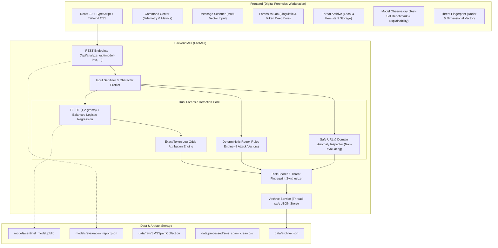

# SENTINEL AI Architecture Specification

SENTINEL AI is an intelligent message-security and digital forensics platform designed for cyber threat intelligence analysts, incident responders, and security researchers.

## 1. System Architecture

## 2. Core Detection Principles

1. **Dual-Layer Intelligence**: Fuses empirical machine-learning probability with deterministic forensic pattern rules. Neither overrides the other blindly; rather, they compound into a transparent, bounded heuristic risk score ($0 \dots 100$).
2. **Explainable Token Attribution**: Because the classification pipeline uses `LogisticRegression` on `TfidfVectorizer` features, token contribution is mathematically derived from $w_i \cdot x_i$, where $w_i$ is the model coefficient and $x_i$ is the TF-IDF feature value. There are no stochastic approximations or misleading mock highlights.
3. **Safe URL Handling**: Extracted hyperlinks are sanitized and inspected purely as text. The engine identifies IP-in-hostname structures, URL shorteners, deceptive brand subdomains, and suspicious TLDs without ever issuing an outbound HTTP request or executing foreign code.
4. **Honest Verdict Semantics**: Benign messages are labeled `NOT FLAGGED AS SPAM` rather than `SAFE`, recognizing the asymmetric and evolving nature of social engineering.
